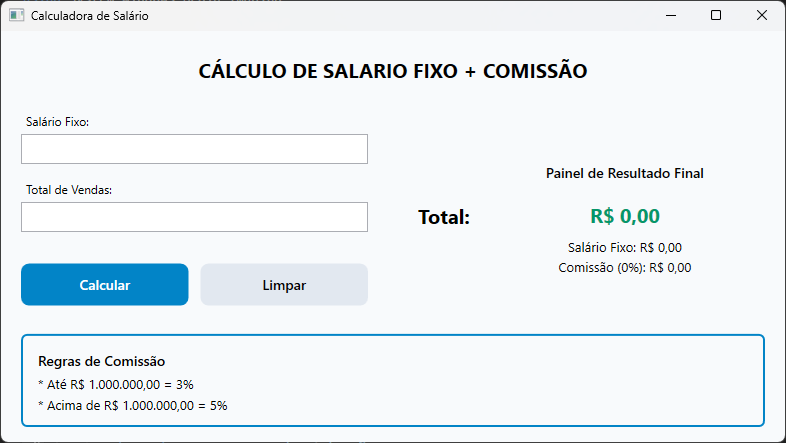

# 💰 Exercício: Cálculo de Salário e Comissão de Vendas

## 📋 Descrição

Desenvolver uma aplicação com interface gráfica (WPF) em C# para calcular o salário total de um vendedor com base no seu salário fixo e no volume total de vendas realizadas, aplicando regras condicionais de comissão.

---

## ⚙️ Requisitos do Exercício

A aplicação deve conter uma tela funcional que atenda às seguintes especificações:

* **Entradas de Dados:**
  * Leitura do valor do **Salário Fixo** do vendedor.
  * Leitura do **Valor Total de Vendas** realizadas.
* **Regras de Negócio (Comissão):**
  * **Até R$ 1.000.000,00** em vendas: comissão de **3%** sobre o valor total vendido.
  * **Acima de R$ 1.000.000,00** em vendas: comissão de **5%** sobre o valor total vendido.
* **Saída de Dados:**
  * Exibir na tela o **Salário Total** do vendedor (soma do salário fixo com o valor da comissão calculada).
 

