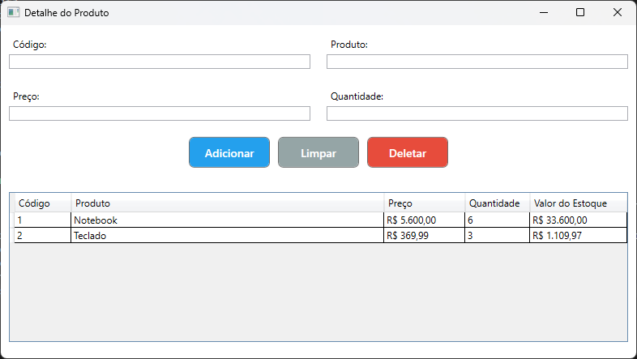

# 📦 Exercício Sugerido: Classe Produto & WPF

## 📋 Descrição

Implementar uma aplicação utilizando C# e WPF para praticar conceitos de encapsulamento, propriedades calculadas e inicialização de objetos.

---

## ⚙️ Requisitos do Exercício

Crie uma classe chamada `Produto` que atenda às seguintes especificações:

* **Propriedades:**
* `Codigo`: Possui leitura pública (`get`) e alteração privada (`private set`).
* `Nome`: Propriedade com leitura e escrita.
* `Preco`: Propriedade com leitura e escrita.
* `Quantidade`: Propriedade com leitura e escrita.

* **Propriedade Calculada:**
* `ValorEstoque`: Propriedade somente leitura que retorna o resultado da multiplicação entre `Preco` e `Quantidade`.

* **Implementação:**
* Instancie um objeto da classe `Produto` utilizando a sintaxe de **Object Initializer**.
* Exiba as informações detalhadas do produto em uma janela **WPF** (Windows Presentation Foundation).

## 🛠️ Implementações Extras (Além do Enunciado Base)

Para tornar a aplicação mais interativa, robusta e próxima de um cenário real de desenvolvimento desktop em WPF, foram implementadas algumas melhorias em relação ao enunciado original:

* **Uso de `DataGrid`:** Em vez de exibir as informações de um único produto estático, a interface foi estruturada com um `DataGrid` para listar múltiplos produtos de forma dinâmica, facilitando a visualização tabular dos dados e do cálculo de estoque.
* **Funcionalidades de Gestão (CRUD Básico):** Foram adicionados botões de controle para tornar a interface funcional:
  * **Adicionar:** Permite cadastrar novos produtos informando os dados nos campos de texto e inserindo-os instantaneamente na tabela.
  * **Deletar:** Permite remover o produto selecionado no `DataGrid`.
  * **Limpar Campos:** Restaura os campos do formulário para o estado vazio com um único clique.

